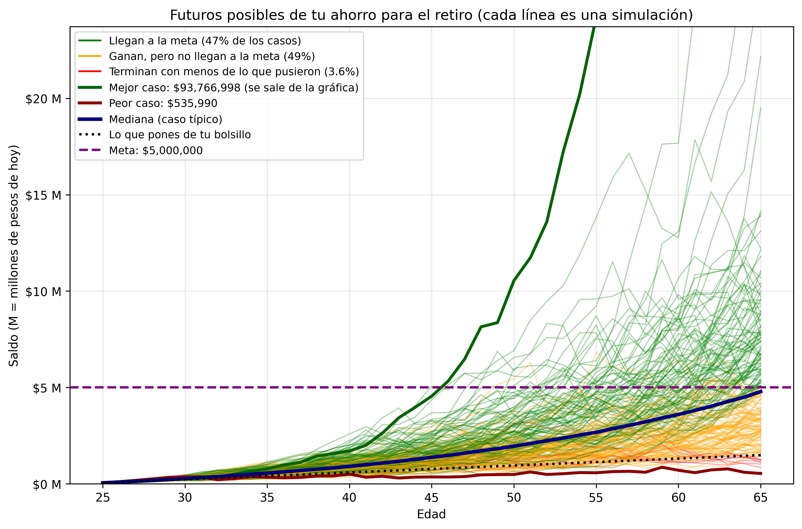

# Simulación de Monte Carlo: Proyección de ahorro para el retiro

**Pensamiento de Ingeniería**
## Edición y ejecución de la simulación

Puedes abrir, editar, jugar y ejecutar con las variables del notebook directamente desde cualquiera de estas plataformas:

- [**Abrir en Google Colab**](https://colab.research.google.com/github/dhernandez007tech-arch/Tarea-8-Simulacion-Montecarlo/blob/main/Simulacion_Montecarlo%20%281%29.ipynb)

## Descripción del código

Este proyecto implementa el método de simulación de Monte Carlo mediante Python para analizar diferentes escenarios de crecimiento de un fondo de ahorro destinado al retiro.

A través de **10,000 simulaciones**, se generan posibles trayectorias del capital acumulado durante un periodo de 40 años, considerando variables como el rendimiento anual, la volatilidad del mercado, las aportaciones periódicas y la inflación.

El propósito es observar cómo la incertidumbre puede influir en el resultado de una estrategia de ahorro a largo plazo.

## Objetivo

Aplicar el método de Monte Carlo para estimar diferentes escenarios financieros y analizar la probabilidad de alcanzar una meta de ahorro al momento del retiro.

## Parámetros de la simulación

| Parámetro | Valor |
|---|---:|
| Edad inicial | 25 años |
| Edad de retiro | 65 años |
| Capital inicial | $50,000 |
| Aportación mensual | $3,000 |
| Rendimiento anual esperado | 10% |
| Volatilidad anual | 15% |
| Inflación anual | 4% |
| Número de simulaciones | 10,000 |
| Meta de ahorro | $5,000,000 |

## Resultados principales

La simulación obtuvo los siguientes resultados:

| Indicador | Resultado |
|---|---:|
| Percentil 5 | $1,651,468 |
| Percentil 25 | $3,049,486 |
| Mediana | $4,787,629 |
| Percentil 75 | $7,579,823 |
| Percentil 95 | $14,672,008 |
| Total aportado | $1,490,000 |
| Probabilidad de alcanzar la meta | 47.4% |

Estos resultados permiten observar la dispersión de los escenarios posibles y comparar el capital final con la meta establecida.

## Metodología

El método de Monte Carlo utiliza números aleatorios para generar múltiples escenarios posibles a partir de determinadas condiciones.

En este proyecto, cada simulación representa una trayectoria posible del ahorro durante el periodo de inversión. Al repetir el proceso 10,000 veces, se obtiene una distribución de resultados que permite estudiar distintos escenarios.

## Limitaciones

Los resultados dependen de los supuestos utilizados en el modelo. Entre sus principales limitaciones se encuentran:

- Los rendimientos anuales se consideran independientes.
- Se utiliza una distribución normal para modelar los rendimientos.
- Los parámetros permanecen constantes durante la simulación.
- Las aportaciones se consideran al inicio de cada año.
- No se incluyen impuestos ni comisiones.
- No se modelan retiros posteriores a la jubilación.

## Resultados visuales

**Gráfica – Abanico de trayectorias**

Esta gráfica muestra cómo podría evolucionar el ahorro para el retiro a lo largo del tiempo. Cada línea representa una simulación diferente y permite observar la variabilidad de los resultados.

**Importante:** Este proyecto tiene fines académicos y educativos. No constituye una recomendación ni asesoría financiera.

---

**Proyecto desarrollado para la materia de Pensamiento de Ingeniería.**
